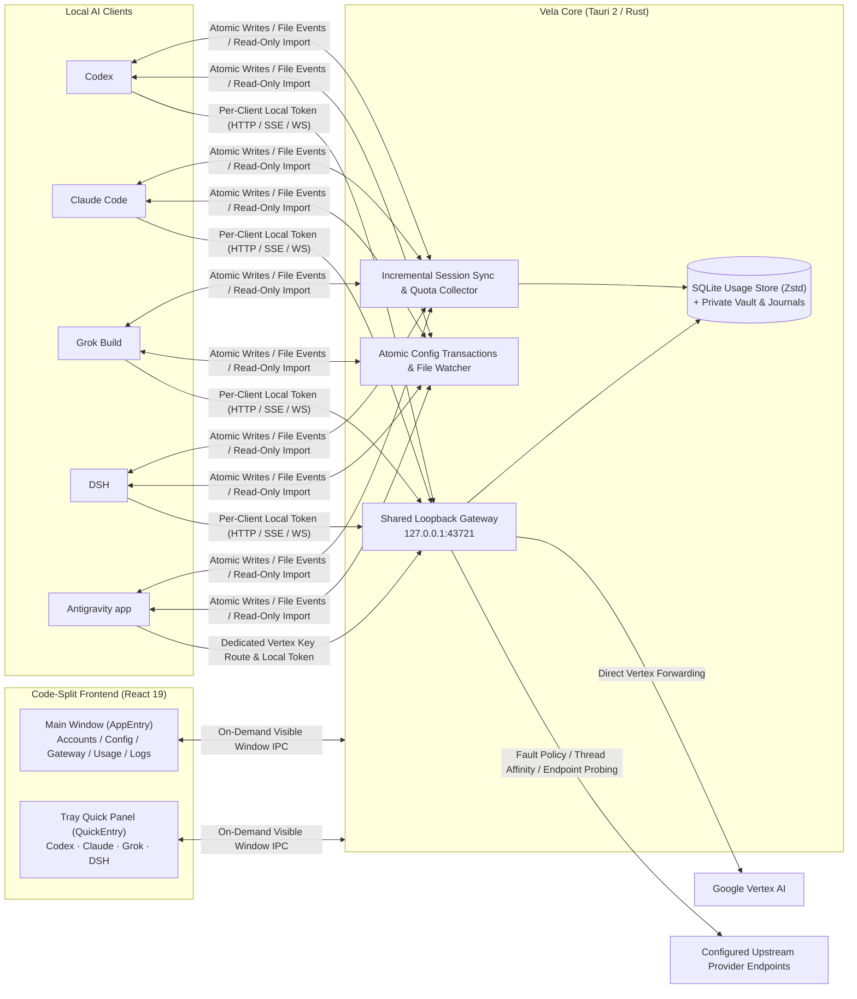

# Vela

<p align="left">
  
</p>

<p align="left">
  <a href="./README.md">简体中文</a> | <strong>English</strong>
</p>

<p align="left">
  
  
  
  
  
  
</p>

A native, local-first multi-client AI account vault, dual-mode configuration studio, and high-availability API gateway workbench for **macOS** and **Windows** (built with **Tauri 2 + Rust + React 19**). Vela unifies isolated provider queues and local traffic routing for **Codex**, **Claude Code**, **Grok Build**, and **DSH**, while providing native multi-credential switching, Vertex API Key routing, real-time remaining quota analytics, incremental session accounting, and bill export for **Antigravity app**.

> **Security & Privacy Guarantee**: All account credentials, provider API keys, and configuration files are stored strictly inside your local user directory (`~/.vela` with `0700`/`0600` permissions). **Zero telemetry, zero cloud sync, and no data is ever uploaded to any third-party or project server.**

---

## Six Signature Highlights

### 1. Real-Time Remaining Quota & Deep Cache Savings Analytics (Claude Code & Antigravity)
- **Stylized Remaining Percentage Badges**: Displays prominent semantic pills (**`剩余 XX%`** / **`配额剩余 XX%`**, colored emerald for `>=50%`, amber for `20%–49%`, and coral for `<20%`) on every **Claude Code** window (`5h`, `7d`, `Sonnet`, `Opus`) and **Antigravity** dual-track window (`Gemini` & `Claude / GPT` `5h` / `7d`), paired with a header **SVG remaining-charge ring** and tightest-window summary pill.
- **Token Mix & Complementary Ratio Meters**: Breaks down fresh input, cache reads, cache writes, visible output, and reasoning tokens with mini progress bars showing **Cache Hit vs. Miss Remaining** and **Reasoning Share vs. Visible Output Remaining**, while calculating exact **estimated cache savings (USD)** from historical price snapshots.
- **Bidirectional Deduplication & Bill Export**: Correlates live gateway streaming metrics (TTFT, generation TPS, cache TTL tiers, reasoning tokens, and web search billing) with incremental local session file cursors across all four clients; exports second-accurate **Claude Code** and **Antigravity app** bills with optional atomic history pruning.

### 2. Menu Bar Quick Panel & Global Sleep Freeze
- **Compact Short-Name Capsule Switcher**: Left-click the menu bar / system tray icon to open the code-split Quick Panel (`420×720`) featuring **`Codex` · `Claude` · `Grok` · `DSH`** short-name capsules (customizable in Settings) with independent client memory.
- **In-Place Queue & Rate Controls**: Reorder provider priority via drag-and-drop, inspect compact balances, edit concurrency caps and RPM limits inline, reset circuit breakers, cancel individual requests waiting over 60 seconds, or cleanly terminate background CLI processes per platform.
- **Global Freeze & Clamshell Sleep Guard**: Engage **Global Freeze** with one click to drain in-flight requests safely before system sleep (resuming remaining wait budgets upon wake), backed by the macOS clamshell power helper (`lmfpd`).

### 3. Single-Port Multi-Client Local Gateway & Zero-Downtime Failover
- **Single-Port Token Multiplexing**: Listens on `127.0.0.1:43721` by default, authenticating and routing each client via dedicated local bearer tokens on `/` and `/v1` (while preserving `/codex`, `/claude`, and `/grok` prefixes); passes HTTP, SSE, and native WebSocket streams through with zero lossy message conversion.
- **Codex Thread Affinity & Compaction Handoff**: Distinguishes true Codex `thread-id`s from cache `session-id`s and empty warmups; supports per-provider **New Thread Takeover** and **Post-Compaction Takeover** with atomic epoch handoffs that never replay already-streamed output.
- **Multi-Endpoint Latency Probing & Fault Policy Engine**: Supports up to 8 auxiliary `base_url`s per provider with credential-free header latency probing to pin the fastest healthy endpoint; includes a structured error classifier with single-box search across HTTP statuses, error codes, and raw JSON payloads.

### 4. Multi-Platform Account Vault & Dual-Mode Configuration Studio
- **Unified Account Vault**: Codex supports browser OAuth, device-code login, lossless token refresh, official direct mode, and batch import/export for Codex / Sub2API / CLIProxyAPI / CC Switch links; Claude Code supports isolated **Official / API** profile switching; Antigravity supports OAuth, ADC, and Vertex API Key accounts.
- **Visual + Code Dual-Mode Editor**:
  - **Claude Code** (`settings.json`) and **Antigravity app** (`config.json`) offer synchronized grouped forms and JSON tree editing that **losslessly preserve unknown and plugin fields**, with secret masking, redacted diff preview, and one-click backup restore.
  - **Codex / Grok Build** (`config.toml`) and **DSH** (YAML patches) provide syntax highlighting, live validation, and external-edit conflict protection.

### 5. Provider Connection Testing & Model Authenticity Verification
- **Streaming Tests & Fingerprinting**: Run per-provider streaming chat tests, **ModelTrace** and **LM Detector** authenticity challenges, and optional tokenizer probes locally.
- **Adaptive Scheduled Inspections**: Configure fixed intervals or traffic-aware dynamic schedules (5–30 minutes based on last-hour request volume, auto-pausing when idle) that automatically flag and quarantine downgraded or mismatched models.

### 6. Atomic Configuration Transactions & Compact Zstd SQLite Storage
- **Self-Healing Cross-File Transactions**: Every client configuration takeover and restore is guarded by private transaction journals (`gateway-takeover.json`, etc.) and optimistic revision locks—automatically rolling back or completing interrupted writes on startup before services initialize.
- **Zstd Dictionary-Compressed SQLite**: Separates hot metric columns from deduplicated pricing snapshots and Zstd-compressed diagnostic blobs, maintaining the main database + WAL around an `~80 MiB` steady-state target (archiving routine diagnostics after 7 days and compacting daily rollups after 30 days).

---

## Client Support Matrix

| Client | Quick Panel Name | Default Local Gateway | Auth & Integration | Configuration Editor | Usage & Quota Analytics |
| --- | --- | --- | --- | --- | --- |
| **Codex** | `Codex` | `127.0.0.1:43721/v1` | Cross-file Bearer or API Key transactions; ChatGPT OAuth vault & official direct mode | `config.toml` validation, managed field guards & backup restore | Live gateway metering + active/archived local session deduplication |
| **Claude Code** | `Claude` | `127.0.0.1:43721` | `settings.json` env integration; isolated Official / API profile switching | `settings.json` **Visual (5 groups) + JSON** dual-mode editor | **Official 5h/7d/Sonnet remaining % badges** + main/subagent deduplication + **Bill export** |
| **Grok Build** | `Grok` | `127.0.0.1:43721/v1` | Dedicated managed API model coexisting with native official OAuth models | `config.toml` validation & `endpoint.env` import preview | Live gateway metering + per-turn multi-model session stats |
| **DSH** | `DSH` | `127.0.0.1:43721/v1` | Chat Completions protocol; multi-profile sync & official model catalog mapping | `desktop` / per-profile YAML patch editor & recovery | Live gateway request & model invocation metering |
| **Antigravity app** | — | Vertex Key: `127.0.0.1:43721/antigravity` | Direct OAuth/ADC in app; Vertex API Key forwarded to Google via Vela | `config.json` **Visual (4 groups) + JSON** dual-mode editor | **Gemini & Claude/GPT dual-track remaining % badges** + incremental `brain` import + **Bill export** |

---

## Architecture Overview



---

## Installation & Checksum Verification

Download the installer for your platform from [GitHub Releases](https://github.com/lich13/vela/releases):

- **macOS (Apple Silicon)**: `.dmg` disk image (ad-hoc signed; if Gatekeeper prompts on first launch, confirm opening under **System Settings → Privacy & Security**).
- **Windows (x64)**: NSIS `.exe` installer (confirm run if prompted by SmartScreen).

Verify the downloaded installer against `SHA256SUMS` attached to the same release:

```sh
# macOS
shasum -a 256 -c SHA256SUMS --ignore-missing
```

```powershell
# Windows PowerShell
Get-FileHash .\Vela_*.exe -Algorithm SHA256
```

See [RELEASE.md](./RELEASE.md) for the full release history.

---

## Local Development & Verification

### Prerequisites
- **Node.js** & **pnpm**: Current stable release (with `--frozen-lockfile`)
- **Rust**: Stable toolchain (see [rust-toolchain.toml](./rust-toolchain.toml))
- **Platform dependencies**: See [Tauri v2 Prerequisites](https://v2.tauri.app/start/prerequisites/)

### Verification Commands

```sh
# 1. Install frontend dependencies
pnpm install --frozen-lockfile

# 2. Frontend unit tests, typecheck, and production build
pnpm test
pnpm build

# 3. Rust unit tests, Clippy lints, and formatting check
cargo test --locked --manifest-path src-tauri/Cargo.toml
cargo clippy --locked --manifest-path src-tauri/Cargo.toml --all-targets -- -D warnings
cargo fmt --manifest-path src-tauri/Cargo.toml -- --check

# 4. Static network host allowlist and error-code consistency gates
python3 scripts/check-network-hosts.py
python3 scripts/check-error-codes.py
python3 -m unittest discover -s scripts -p "test_*.py"
```

- **Privacy & Network Boundaries**: Documented in [PRIVACY.md](./PRIVACY.md) and enforced offline by `scripts/check-network-hosts.py`. Report security vulnerabilities privately via [GitHub Security Advisories](https://github.com/lich13/vela/security/advisories/new).

---

## License

MIT License. Vela is an independent open-source project and is not affiliated with OpenAI, Anthropic, xAI, or Google.
