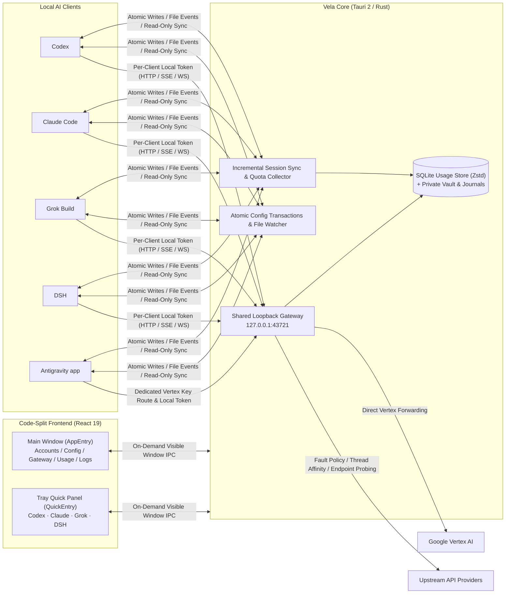

# Vela

<p align="left">
  
</p>

<p align="left">
  <a href="./README.md">简体中文</a> | <strong>English</strong>
</p>

<p align="left">
  
  
  
  
  
  
</p>

**Vela** is a native, local-first AI client manager and high-availability API gateway for **macOS** and **Windows** (built with **Tauri 2 + Rust + React 19**).

Designed for developers working across **Codex**, **Claude Code**, **Grok Build**, **DSH**, and **Antigravity app**, Vela provides a unified local workbench to manage multi-platform credentials, route local traffic with automatic failover, safely edit client configurations, and track real-time quotas and granular token usage.

> **Security & Privacy Commitment**: All account credentials, provider API keys, and configuration files are stored strictly inside your local user directory (`~/.vela` with `0700`/`0600` permissions). **Zero telemetry, zero cloud sync, and no data is ever uploaded to any third-party or project server.** Official vs. third-party API profile isolation operates strictly on local files and does not guarantee bypassing upstream platform risk controls.

---

## Key Features

### 1. Real-Time Quota Tracking & Cache Savings Analytics (Claude Code & Antigravity)
- **Remaining Quota Indicators**: Displays real-time remaining quota percentages across **Claude Code** windows (`5h`, `7d`, `Sonnet`, `Opus`) and **Antigravity** dual-track windows (`Gemini` & `Claude / GPT` `5h` / `7d`), complete with status color coding and a header ring indicator highlighting the most constrained window.
- **Token Breakdown & Cache Savings (USD)**: Automatically separates fresh input, cache reads, cache writes, visible output, and reasoning tokens. Visual meters display **cache hit rates** and **reasoning token ratios**, while calculating exact **estimated cache savings in USD** from historical pricing snapshots.
- **Bidirectional Deduplication & Bill Export**: Correlates live gateway streaming metrics (TTFT, generation TPS, cache TTL tiers, reasoning tokens, and web search billing) with incremental local session file cursors across all four clients to prevent double-counting. Supports exporting second-accurate bills for **Claude Code** and **Antigravity app**, with optional atomic pruning of settled history.

### 2. Menu Bar Quick Panel & System Sleep Control
- **Lightweight Tray Access**: Left-click the menu bar / system tray icon to open the code-split Quick Panel, allowing instant switching between **`Codex` · `Claude` · `Grok` · `DSH`** (unused platforms can be hidden in Settings) with independent state memory and real-time synchronization.
- **In-Place Queue & Rate Management**: Reorder provider priority via drag-and-drop, inspect account balances, adjust concurrency caps and RPM limits inline, reset circuit breakers, cancel individual requests pending for over 60 seconds, or cleanly terminate background CLI processes per platform—all without opening the main window.
- **Global Freeze & Clamshell Sleep Guard**: Engage **Global Freeze** with one click to allow in-flight requests to finish safely before pausing traffic (resuming remaining timeout budgets upon wake), backed by a native macOS clamshell power helper to prevent system sleep from interrupting long-running tasks.

### 3. Single-Port Multi-Client Gateway & Zero-Downtime Failover
- **Single-Port Token Multiplexing**: Listens on `127.0.0.1:43721` by default, authenticating and routing each client via dedicated local bearer tokens on `/` and `/v1` (while preserving `/codex`, `/claude`, and `/grok` prefixes for compatibility). Passes HTTP, SSE, and native WebSocket streams through with zero lossy protocol conversion.
- **Codex Thread Affinity & Compaction Handoff**: Accurately distinguishes true Codex `thread-id`s from cache `session-id`s and empty warmups. Supports per-provider **New Thread Takeover** and **Post-Compaction Takeover** with atomic epoch handoffs that never replay already-streamed output.
- **Multi-Endpoint Probing & Fault Policy Search**: Supports 1 primary address and up to 8 auxiliary `base_url`s per provider with credential-free header latency probing to automatically select the fastest healthy endpoint. Includes a structured error classifier with single-box search across HTTP statuses, error codes, and raw JSON payloads to quickly locate matching failover rules.

### 4. Multi-Platform Account Vault & Dual-Mode Configuration Center
- **Centralized Account Vault**:
  - **Codex**: Supports browser OAuth, device-code login, lossless token refresh, official direct mode, and batch import/export for Codex / Sub2API / CLIProxyAPI / CC Switch formats.
  - **Claude Code**: Supports isolated **Official vs. API** profile switching without configuration collisions.
  - **Antigravity**: Manages OAuth, ADC, and Vertex API Key accounts in one place.
- **Visual Form + Code Dual-Mode Editor**:
  - **Claude Code** (`settings.json`) and **Antigravity app** (`config.json`) offer synchronized grouped forms and JSON tree editors that **losslessly preserve unknown custom fields and plugin settings**, complete with secret masking, redacted diff previews, and one-click backup restore.
  - **Codex / Grok Build** (`config.toml`) and **DSH** (YAML patches) provide syntax highlighting, live validation, and external-edit conflict protection.

### 5. Provider Connectivity Testing & Model Fingerprint Attribution
- **Streaming Tests & Offline Fingerprint Attribution**: Run per-provider streaming chat tests, [ModelTrace](https://github.com/Hanmo123/ModelTrace) and [LM Detector](https://github.com/Ikaleio/lm-detector) (`lmfpd`) model fingerprint challenges, and optional tokenizer probes. All reference comparisons and closed-set statistical attribution scoring are executed offline locally without routing through upstream proxy services.
- **Adaptive Scheduled Inspections**: Configure fixed intervals or traffic-aware dynamic schedules (5–30 minutes based on last-hour request volume, auto-pausing when idle). When statistical attribution results trigger locally configured degradation threshold rules (supporting strict/lenient modes), Vela automatically flags the endpoint and removes it from the active routing queue.

### 6. Atomic Configuration Transactions & Compact Local Storage
- **Self-Healing Cross-File Transactions**: Every client configuration takeover and restore is guarded by private transaction journals (`gateway-takeover.json`, etc.) and optimistic revision locks—automatically rolling back or completing interrupted writes on startup before services initialize, never corrupting original user configurations.
- **Zstd Dictionary-Compressed SQLite**: Separates hot metric columns from deduplicated pricing snapshots and Zstd-compressed diagnostic blobs, maintaining the main database and WAL around an `~80 MiB` steady-state target (archiving routine diagnostics after 7 days and compacting daily rollups after 30 days).

---

## Client Support Matrix

| Client | Quick Panel | Default Local Gateway | Auth & Integration | Configuration Editor | Usage & Quota Analytics |
| --- | --- | --- | --- | --- | --- |
| **Codex** | `Codex` | `127.0.0.1:43721/v1` | Cross-file Bearer or API Key transactions; ChatGPT OAuth vault & official direct mode | `config.toml` validation, managed field guards & backup restore | Live gateway metering + active/archived local session deduplication |
| **Claude Code** | `Claude` | `127.0.0.1:43721` | `settings.json` env integration; isolated Official / API profile switching | `settings.json` **Visual (5 groups) + JSON** dual-mode editor | **Official 5h/7d/Sonnet remaining %** + main/subagent deduplication + **Bill export** |
| **Grok Build** | `Grok` | `127.0.0.1:43721/v1` | Dedicated managed API model coexisting with native official OAuth models | `config.toml` validation & `endpoint.env` import preview | Live gateway metering + per-turn multi-model session stats |
| **DSH** | `DSH` | `127.0.0.1:43721/v1` | Chat Completions protocol; multi-profile sync & official model catalog mapping | `desktop` / per-profile YAML patch editor & recovery | Live gateway request & model invocation metering |
| **Antigravity app** | — | Vertex Key: `127.0.0.1:43721/antigravity` | Direct OAuth/ADC in app; Vertex API Key forwarded to Google via Vela | `config.json` **Visual (4 groups) + JSON** dual-mode editor | **Gemini & Claude/GPT dual-track remaining %** + incremental session sync + **Bill export** |

---

## Architecture Overview



---

## Installation & Checksum Verification

Download the installer for your platform from [GitHub Releases](https://github.com/lich13/vela/releases):

- **macOS (Apple Silicon)**: `.dmg` disk image (ad-hoc signed; if Gatekeeper prompts on first launch, confirm opening under **System Settings → Privacy & Security**).
- **Windows (x64)**: NSIS `.exe` installer (confirm execution if prompted by SmartScreen).

Verify the downloaded installer against the `SHA256SUMS` file attached to the same release:

```sh
# macOS
shasum -a 256 -c SHA256SUMS --ignore-missing
```

```powershell
# Windows PowerShell
Get-FileHash .\Vela_*.exe -Algorithm SHA256
```

See [RELEASE.md](./RELEASE.md) for the full release history.

---

## Quick Start

1. **Configure & Enable the Gateway**: Open the **Gateway** tab in the main window, select your target client (Codex / Claude Code / Grok Build / DSH), add upstream providers, and configure queue order, concurrency, and RPM limits. Toggle the gateway switch on and restart the corresponding client to apply (switching providers while running only affects new requests without interrupting active streams).
2. **Control from the Quick Panel**: Click the menu bar / system tray icon to open the Quick Panel. Switch between **`Codex` / `Claude` / `Grok` / `DSH`** in one click to reorder providers, check balances, cancel long-waiting requests, or engage **Global Freeze**.
3. **Monitor Quotas & Export Bills**: Switch to the **Claude Code** or **Antigravity** view under the **Usage** tab to inspect remaining quota percentages, token mix breakdowns, estimated cache savings, and session rankings, or click **Export Bill** to generate an itemized statement.
4. **Edit Configs Safely**: Use the visual form or code editor under the **Config** tab to maintain client configurations. Preview redacted diffs before saving, and restore the previous backup with one click if needed.

Further documentation:
- [Design System & Interaction Spec (DESIGN.md)](./DESIGN.md) · [Privacy & Security Boundaries (PRIVACY.md)](./PRIVACY.md)
- [Client Integration & Config (docs/clients.md)](./docs/clients.md) · [Gateway Routing & Failover (docs/gateway.md)](./docs/gateway.md)
- [Quick Panel & System Controls (docs/controls.md)](./docs/controls.md) · [Usage Accounting & Pricing (docs/usage.md)](./docs/usage.md) · [Data Directory & Recovery (docs/data.md)](./docs/data.md)

---

## Local Development & Verification

### Prerequisites
- **Node.js** & **pnpm**: Current stable release (with `--frozen-lockfile`)
- **Rust**: Stable toolchain (see [rust-toolchain.toml](./rust-toolchain.toml))
- **Platform dependencies**: See [Tauri v2 Prerequisites](https://v2.tauri.app/start/prerequisites/)

### Verification Commands

```sh
# 1. Install frontend dependencies
pnpm install --frozen-lockfile

# 2. Frontend unit tests, typecheck, and production build
pnpm test
pnpm build

# 3. Rust unit tests, Clippy lints, and formatting check
cargo test --locked --manifest-path src-tauri/Cargo.toml
cargo clippy --locked --manifest-path src-tauri/Cargo.toml --all-targets -- -D warnings
cargo fmt --manifest-path src-tauri/Cargo.toml -- --check

# 4. Static network host allowlist and error-code consistency gates
python3 scripts/check-network-hosts.py
python3 scripts/check-error-codes.py
python3 -m unittest discover -s scripts -p "test_*.py"
```

- **Privacy & Network Boundaries**: Documented in [PRIVACY.md](./PRIVACY.md) and enforced offline by `scripts/check-network-hosts.py`.
- **Dependabot & Dependency Policy**: Checks compatible `minor/patch` updates for Cargo, npm, and GitHub Actions every Monday (ignoring breaking major upgrades and grouping frontend updates into a single `frontend-compatible` group to avoid lockfile conflicts).
- **Security Reporting**: Please report security vulnerabilities privately via [GitHub Security Advisories](https://github.com/lich13/vela/security/advisories/new).

---

## Open-Source Acknowledgments & Disclaimers

### Third-Party Acknowledgments
- **Model Fingerprint Attribution Algorithms & Public Reference Banks**:
  - **[ModelTrace](https://github.com/Hanmo123/ModelTrace)** (derived from [xqy2006/ModelTrace](https://github.com/xqy2006/ModelTrace), MIT License, Copyright (c) 2026 xqy2006): Provides the long-integer sequence challenge design, Hellinger statistical attribution algorithm reference, and the `unified_bank.json` public reference bank.
  - **[LM Detector](https://github.com/Ikaleio/lm-detector)** (`lmfpd`, MIT License, Copyright (c) 2026 xqy2006): Provides the offline fingerprint challenge and scoring Rust SDK (`lmfpd`), tokenizer posterior probing algorithm reference, and public model reference bundle.
- For the complete list of third-party components, algorithm port notes, and license texts, see [THIRD_PARTY_NOTICES.md](./THIRD_PARTY_NOTICES.md) and the [licenses/](./licenses/) directory.

### Model Fingerprinting & Degradation Detection Disclaimer
1. **Statistical Attribution Nature (Not Authenticity Certification)**: Both ModelTrace and LM Detector perform **closed-set statistical distribution ranking (Closed-set Statistical Attribution)** against currently bundled or public reference banks—not cryptographic model identity authentication or official signature verification. Unlisted models will still be matched to the closest known candidate in the reference bank; fine-tuning/quantization, sampling parameters, system prompts, context environment, and gateway post-processing can all significantly affect matching scores and rankings.
2. **No Evaluation or Endorsement of Providers**: All tests are configured and initiated locally by the user solely to assist local gateway routing. **Results do not constitute model authenticity certification, service quality endorsement, or fraud accusation against any third-party API provider, relay, or channel.** Do not use test results, confidence rankings, or degradation flags from this software as the basis for complaints, refunds, claims, public accusations, or any legal disputes.
3. **Separation of Liability from Upstream Projects**: ModelTrace and LM Detector provide only the underlying challenges, statistical scoring algorithms, and public reference data. The strict/lenient degradation threshold rules and automatic queue removal policies in Vela are independently defined and executed by Vela, and are unrelated to the upstream projects or their authors. Neither the upstream authors nor the authors of this project assume any direct or indirect liability for detection results or any disputes arising therefrom.
4. **Cost & Compliance Responsibility**: Direct connection tests, tokenizer probes, and scheduled inspections send requests directly to user-configured endpoints using user-provided credentials without routing through any third-party detection proxy. Any resulting API token consumption and compliance with the target provider's Terms of Service (ToS) are the sole responsibility of the user.

---

## License

[MIT License](./LICENSE). Vela is an independent open-source project and is not affiliated with OpenAI, Anthropic, xAI, Google, or any of the integrated third-party open-source projects.
