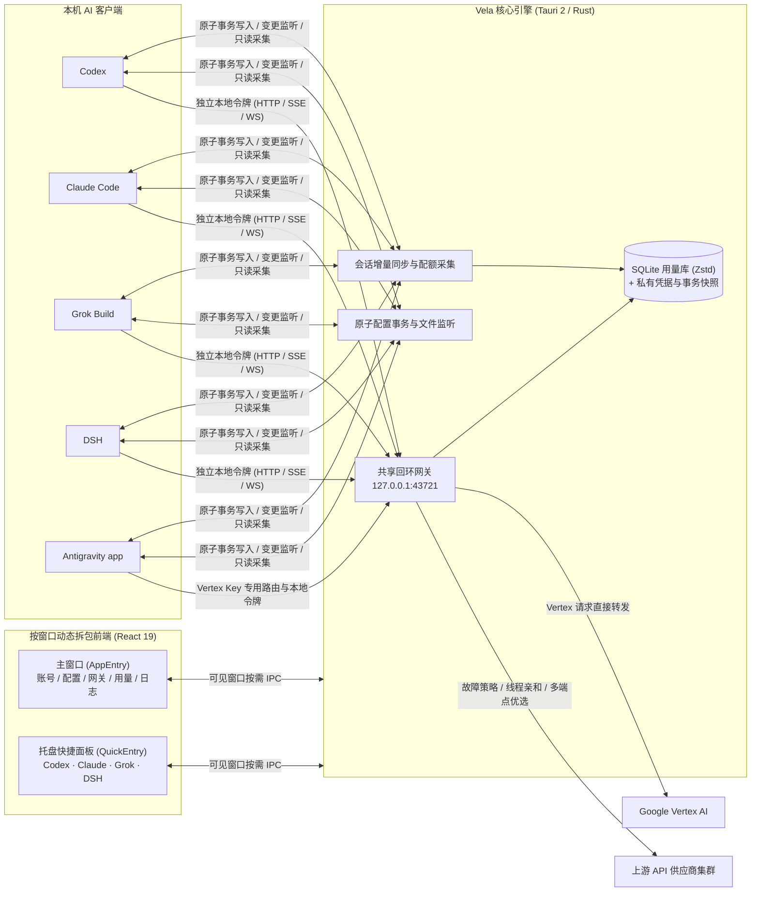

# Vela

<p align="left">
  
</p>

<p align="left">
  <strong>简体中文</strong> | <a href="./README.en.md">English</a>
</p>

<p align="left">
  
  
  
  
  
  
</p>

**Vela** 是一款面向 **macOS** 与 **Windows** 的本地 AI 客户端管理工具与高可用 API 网关（基于 **Tauri 2 + Rust + React 19** 构建）。

针对日常同时使用 **Codex**、**Claude Code**、**Grok Build**、**DSH** 及 **Antigravity app** 的开发者，Vela 提供了一套统一的本地解决方案：集中管理多平台账号与 API 密钥、按客户端独立调度网关流量与故障转移、安全编辑本地配置文件，并提供实时的配额监控与精细化用量账单核算。

> **隐私与安全承诺**：所有账号凭据、API 密钥与配置文件均严格保存在本机当前系统账户的私有目录下（`~/.vela`，权限 `0700`/`0600`）。**零遥测、零云端同步，不向任何第三方或项目服务器上传数据**。官方与第三方 API 配置隔离仅作用于本机文件层面，不承诺规避上游平台风控。

---

## 核心特性

### 1. 实时配额监控与缓存节省核算（Claude Code & Antigravity）
- **直观的剩余配额展示**：实时呈现 **Claude Code**（`5h`、`7d`、`Sonnet`、`Opus`）与 **Antigravity**（`Gemini`、`Claude / GPT` 双轨 `5h` / `7d`）各周期的剩余配额百分比，并通过状态色与顶部环形指示器突出提示最紧缺的配额周期。
- **Token 构成分析与缓存收益计算**：自动拆解新输入、缓存读取、缓存写入、常规输出与思考（Reasoning）Token 的构成比例，直观展示**缓存命中率**与**思考 Token 占比**，并基于请求当时的历史价格快照，精确核算**由缓存机制节省的估算金额（USD）**。
- **双向增量去重与账单导出**：将网关实时采集的流式指标（首字延迟 TTFT、生成速度 TPS、缓存 TTL 明细、推理 Token、联网搜索计费）与本机四端会话文件增量游标自动关联去重。支持导出精确到秒的 **Claude Code** 与 **Antigravity app** 核对账单，并支持按截止时间安全清理已结清历史记录。

### 2. 托盘快捷面板与全局休眠控制
- **轻量级托盘快捷操作**：点击系统菜单栏或托盘图标即可呼出独立拆包的快捷面板，支持在 **`Codex` · `Claude` · `Grok` · `DSH`** 之间快速切换（可在设置中按需隐藏不常用平台），面板状态与主窗口独立记忆、实时同步。
- **就地队列调度与限流管理**：无需打开主窗口，即可在快捷面板中拖拽调整供应商优先级、查看账户余额、就地修改并发上限与 RPM 限流、一键重置熔断状态、逐条中止超过 60 秒的长等待请求，或按平台安全退出后台 CLI 进程。
- **全局冻结与防合盖休眠**：支持一键开启**「全局冻结」**（等待当前在途请求安全完成后暂停接收新请求，系统唤醒后按剩余超时预算无损恢复），并配备 macOS 原生防合盖休眠电源助手，防止休眠导致长耗时任务中断。

### 3. 单端口多客户端网关与无感故障转移
- **单端口令牌分流**：默认监听本地 `127.0.0.1:43721`，通过各客户端独立的本地访问令牌在根路径 `/` 或 `/v1` 精确完成鉴权与路由分流；HTTP、SSE 与原生 WebSocket 全程保持原协议无损透传。
- **Codex 线程亲和与压缩交接**：精准识别 Codex 的真实对话 `thread-id`（自动排除缓存亲和 `session-id` 与空预热请求），支持按供应商独立开启「新线程接管」与「上下文压缩后接管」，按代次原子交接，确保已输出内容不重复回放。
- **多端点测速与故障策略检索**：每家供应商支持配置 1 个主地址与最多 8 个备用 `base_url`，支持发起免凭据响应头延迟探测并自动优选最快可达节点；内置结构化错误分类引擎，支持直接粘贴 HTTP 状态码、错误码或原始报错 JSON，快速定位命中的故障转移策略。

### 4. 多平台账号管理与双模式配置中心
- **集中式账号管理**：
  - **Codex**：支持浏览器 OAuth、设备码登录、指定账号无损刷新、官方直连模式，以及 Codex / Sub2API / CLIProxyAPI / CC Switch 格式的批量导入与导出。
  - **Claude Code**：支持「官方直连 / 第三方 API」配置档隔离切换，互不覆盖。
  - **Antigravity**：支持 OAuth、ADC 与 Vertex API Key 多账号集中管理。
- **可视化表单 + 代码双模式编辑**：
  - **Claude Code**（`settings.json`）与 **Antigravity app**（`config.json`）提供分组可视化表单与 JSON 树双模式同步编辑，**无损保留未知自定义字段与插件配置**，内置敏感值遮蔽、脱敏 Diff 预览与一键「恢复上次配置」。
  - **Codex / Grok Build**（`config.toml`）与 **DSH**（YAML patch）提供语法高亮、即时校验与外部修改冲突保护。

### 5. 供应商直连测试与模型指纹归因
- **直连流式测试与离线指纹归因**：支持按供应商独立发起流式对话测试、[ModelTrace](https://github.com/Hanmo123/ModelTrace) 与 [LM Detector](https://github.com/Ikaleio/lm-detector)（`lmfpd`）模型指纹挑战及可选分词器探测。所有参考库比对与闭集统计归因评分均在本地离线完成，不经过上游项目的在线代理服务。
- **自适应定时巡检**：支持按固定周期巡检，或根据近一小时的实际业务请求量动态调整巡检间隔（5–30 分钟，零调用时自动暂停）。当统计归因结果触发本地预设的降级判定规则（支持严格/宽松模式）时，自动标记该节点并移出可用路由队列。

### 6. 原子级配置事务与紧凑型本地存储
- **跨文件事务自愈机制**：所有客户端配置的接管与还原均通过本地私有事务日志（`gateway-takeover.json` 等）与乐观锁版本校验执行；即便遭遇进程异常中断，下次启动时也会在加载服务前自动完成事务回滚或补齐，绝不污染用户原有配置。
- **Zstd 字典压缩 SQLite 存储**：用量数据库采用计量列分离、内容摘要共享定价快照与带校验和的 Zstd 字典无损压缩（常规诊断正文 7 天归档，30 天收敛为按日汇总），将主数据库与 WAL 体积常态维持在约 `80 MiB`。

---

## 客户端支持矩阵

| 客户端 | 快捷面板标识 | 默认本地网关入口 | 接入与认证机制 | 配置编辑支持 | 用量采集与配额透视 |
| --- | --- | --- | --- | --- | --- |
| **Codex** | `Codex` | `127.0.0.1:43721/v1` | Bearer 或 API Key 跨文件事务接管；ChatGPT OAuth 账号库与官方直连 | `config.toml` 语法校验、受管字段保护与备份恢复 | 网关实时计量 + 本机活跃/归档会话双向去重 |
| **Claude Code** | `Claude` | `127.0.0.1:43721` | `settings.json` 环境变量接入；官方 / API 配置档隔离切换 | `settings.json` **可视化表单（5 分组）+ JSON** 双模式 | **官方 5h/7d/Sonnet 剩余配额百分比** + 主/子代理会话去重 + **账单导出** |
| **Grok Build** | `Grok` | `127.0.0.1:43721/v1` | 独立受管 API 模型接入，保留原生官方 OAuth 模型自由切换 | `config.toml` 校验与 `endpoint.env` 导入预览 | 网关实时计量 + 原生多模型按轮次独立统计 |
| **DSH** | `DSH` | `127.0.0.1:43721/v1` | Chat Completions 协议；全 profile 事务同步与官方模型目录映射 | `desktop` / 各 profile YAML patch 编辑与恢复 | 网关实时请求与模型调用计量 |
| **Antigravity app** | — | Vertex Key：`127.0.0.1:43721/antigravity` | OAuth / ADC 由客户端直连；Vertex API Key 经 Vela 转发至 Google | `config.json` **可视化表单（4 分组）+ JSON** 双模式 | **Gemini & Claude/GPT 双轨剩余配额百分比** + 会话增量采集 + **账单导出** |

---

## 系统架构概览



---

## 安装与完整性校验

请从 [GitHub Releases](https://github.com/lich13/vela/releases) 下载对应平台的安装包：

- **macOS（Apple Silicon）**：`.dmg` 磁盘映像（采用 ad-hoc 签名；首次打开如遇系统拦截，请按 macOS 提示在「系统设置 → 隐私与安全性」中确认打开）。
- **Windows（x64）**：NSIS `.exe` 安装程序（SmartScreen 提示时选择确认运行即可）。

下载后建议使用同一 Release 附带的 `SHA256SUMS` 文件校验安装包完整性：

```sh
# macOS
shasum -a 256 -c SHA256SUMS --ignore-missing
```

```powershell
# Windows PowerShell
Get-FileHash .\Vela_*.exe -Algorithm SHA256
```

历史版本演进详见 [发布说明 (RELEASE.md)](./RELEASE.md)。

---

## 快速上手

1. **配置并启用网关**：打开主窗口进入「网关」页，选择目标客户端（Codex / Claude Code / Grok Build / DSH），添加上游供应商并设置队列顺序、并发数与 RPM 上限；打开网关开关后重启对应客户端即可生效（运行期间切换供应商仅作用于新请求，不中断已有流式响应）。
2. **使用托盘快捷面板**：点击系统菜单栏或托盘图标唤起快捷面板，在 **`Codex` / `Claude` / `Grok` / `DSH`** 之间一键切换，随时调整路由顺序、查看余额、中止超时长等待请求或开启「全局冻结」。
3. **监控配额与导出账单**：在「用量」页切换至 **Claude Code** 或 **Antigravity** 视图，实时查看各周期剩余配额百分比、Token 构成、缓存命中节省金额与会话消耗排行，或点击「导出账单」生成核对账单。
4. **双模式安全改配**：在「配置」页使用可视化表单或代码编辑器维护客户端配置，保存前可通过「查看改动」核对脱敏差异，误操作可随时点击「恢复上次配置」进行回滚。

更多专题文档：
- [设计系统与交互规范 (DESIGN.md)](./DESIGN.md) · [隐私与安全边界 (PRIVACY.md)](./PRIVACY.md)
- [客户端接入与配置 (docs/clients.md)](./docs/clients.md) · [网关调度与故障转移 (docs/gateway.md)](./docs/gateway.md)
- [快捷面板与系统控制 (docs/controls.md)](./docs/controls.md) · [用量核算与计价口径 (docs/usage.md)](./docs/usage.md) · [数据目录与事务恢复 (docs/data.md)](./docs/data.md)

---

## 本地构建与开发

### 环境要求
- **Node.js** & **pnpm**：使用当前稳定版（建议启用 `--frozen-lockfile`）
- **Rust**：稳定版工具链（见 [rust-toolchain.toml](./rust-toolchain.toml)）
- **系统依赖**：参见 [Tauri v2 Prerequisites](https://v2.tauri.app/start/prerequisites/)

### 常用验证命令

```sh
# 1. 安装前端依赖
pnpm install --frozen-lockfile

# 2. 前端单元测试、类型检查与生产构建
pnpm test
pnpm build

# 3. Rust 单元测试、Clippy 静态检查与格式校验
cargo test --locked --manifest-path src-tauri/Cargo.toml
cargo clippy --locked --manifest-path src-tauri/Cargo.toml --all-targets -- -D warnings
cargo fmt --manifest-path src-tauri/Cargo.toml -- --check
```

- **隐私与网络边界**：详细规范见 [PRIVACY.md](./PRIVACY.md)。
- **Dependabot 与依赖策略**：每周一自动检查 Cargo、npm 与 GitHub Actions 的兼容 `minor/patch` 更新（自动忽略跨主版本破坏性升级，前端合并为单一 `frontend-compatible` 组以避免锁文件冲突）。
- **安全漏洞报告**：发现安全问题请通过 [GitHub Security Advisories](https://github.com/lich13/vela/security/advisories/new) 私下报告。

---

## 开源致谢与免责声明

### 第三方开源致谢
- **模型指纹检测算法与公开参考库**：
  - **[ModelTrace](https://github.com/Hanmo123/ModelTrace)**（衍生自 [xqy2006/ModelTrace](https://github.com/xqy2006/ModelTrace)，MIT License，Copyright (c) 2026 xqy2006）：提供长整数序列挑战设计、Hellinger 统计归因算法参考及 `unified_bank.json` 公开指纹参考库。
  - **[LM Detector](https://github.com/Ikaleio/lm-detector)**（`lmfpd`，MIT License，Copyright (c) 2026 xqy2006）：提供离线指纹挑战与评分 Rust SDK（`lmfpd`）、分词器后验探测算法参考及公开模型参考数据包。
- 完整的第三方开源组件清单、算法移植说明及许可证原文详见 [THIRD_PARTY_NOTICES.md](./THIRD_PARTY_NOTICES.md) 与 [licenses/](./licenses/) 目录。

### 模型指纹与「降智」检测免责声明
1. **统计归因性质（非真伪鉴定）**：ModelTrace 与 LM Detector 的输出本质均为**当前内置／公开参考库内的闭集统计分布排序（Closed-set Statistical Attribution）**，并非密码学意义上的模型身份认证或官方签名验证。未收录于参考库的新模型也会被匹配至分布最相近的已知候选；模型微调／量化、采样参数、系统提示词、上下文环境及网关后处理均可能显著影响匹配分数与排名。
2. **不评价任何服务商**：所有测试均由用户在本地自行配置并发起，仅用于辅助本机网关路由调度，**不构成对任何第三方 API 服务商、中转站或渠道的模型真实性认定、服务质量背书或欺诈指控**。请勿将本软件的测试结果、排名置信度或「降智」标记作为投诉、退款、索赔、公开指控或任何法律争议的依据。
3. **上游项目责任切割**：ModelTrace 与 LM Detector 仅提供底层挑战、统计评分算法与公开参考数据；Vela 中的「严格／宽松降智判定规则」及「自动移出路由队列」策略均由 Vela 独立定义与执行，与两个上游项目及其作者无关。上游项目作者及本项目作者均不对任何检测结果或由此引发的争议承担任何直接或间接责任。
4. **费用与合规责任**：直连测试、分词器探测与定时巡检直接使用用户配置的凭据向目标端点发起请求，不经过任何第三方检测代理；由此产生的 API 额度消耗及是否符合目标服务商的使用条款（ToS）由用户自行承担。

---

## 社区

问题反馈与功能建议请使用 [GitHub Issues](https://github.com/lich13/vela/issues)。

感谢 [LINUX DO](https://linux.do) 社区提供开放、友善的技术交流平台。

---

## 许可证

[MIT License](./LICENSE)。本项目为独立开源项目，与 OpenAI、Anthropic、xAI、Google 等厂商及所接入的第三方开源项目无任何隶属或合作关系。
