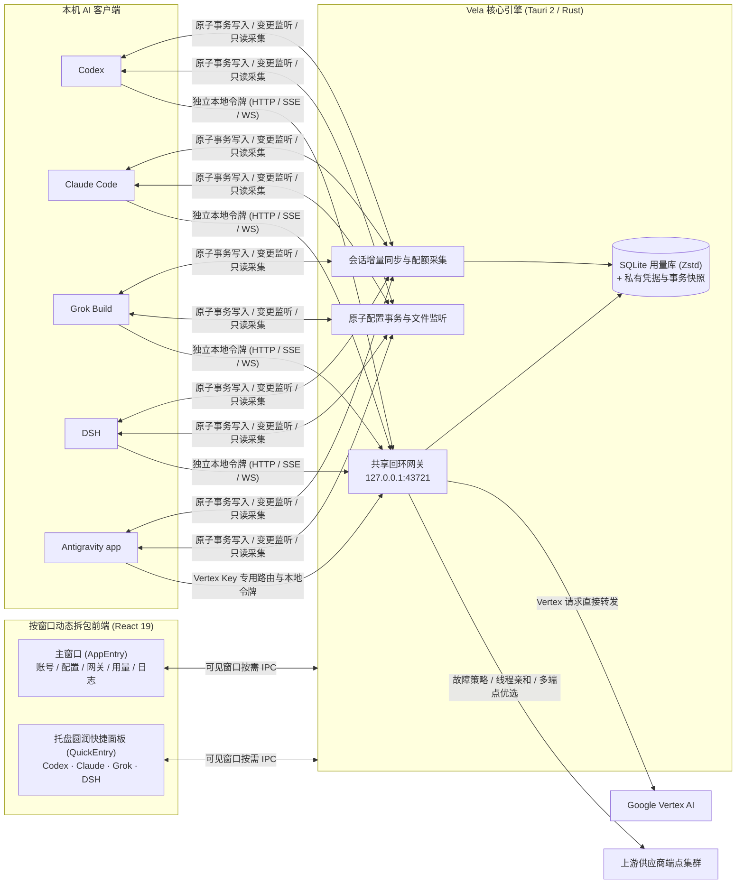

# Vela

<p align="left">
  
</p>

<p align="left">
  <strong>简体中文</strong> | <a href="./README.en.md">English</a>
</p>

<p align="left">
  
  
  
  
  
  
</p>

面向 **macOS** 与 **Windows** 的本地多客户端 AI 账号金库、双模配置中心与高可用 API 网关工作台（基于 **Tauri 2 + Rust + React 19** 构建）。一站式管理 **Codex**、**Claude Code**、**Grok Build**、**DSH** 的独立供应商队列与本地流量调度，并原生支持 **Antigravity app** 的多源凭据切换、Vertex API Key 路由、实时剩余配额透视、增量会话用量核算与账单导出。

> **安全与隐私承诺**：所有账号凭据、供应商密钥与配置文件均保存在本机当前系统账户私有目录下（`~/.vela`，权限 `0700`/`0600`），**零遥测、零云端同步、不上传任何第三方或项目服务**。官方与第三方 API 配置隔离仅作用于本机文件，不承诺规避上游平台风控。

---

## 六大核心特色

### 1. Claude Code & Antigravity 实时剩余配额与缓存节省透视
- **剩余百分比高亮徽章**：在 **Claude Code**（`5h`、`7d`、`Sonnet`、`Opus`）与 **Antigravity**（`Gemini`、`Claude / GPT` 双轨 `5h` / `7d`）配额卡片右上角突出展示 **`剩余 XX%`** / **`配额剩余 XX%`** 语义胶囊（`>=50%` 翠绿、`20%–49%` 琥珀橙、`<20%` 珊瑚红），头部配备 **5h 剩余电量微型环形指示器（SVG Ring）** 与 **`最紧剩余 XX%`** 汇总胶囊。
- **Token 构成与互补占比微缩槽**：自动拆解新输入、缓存读取、缓存写入、可见输出与思考输出，直观呈现**缓存命中率 vs 未命中剩余**、**思考占输出比 vs 可见剩余**微缩对比进度条，并按请求保存的历史快照精确核算**缓存估算节省金额（USD）**。
- **双向增量去重与账单导出**：网关流式计量（TTFT 首字延迟、生成 TPS、缓存 TTL 明细、推理 Token、网络搜索计费）与本机四端会话文件增量游标自动关联去重；支持导出精确到秒的 **Claude Code** 与 **Antigravity app** 核对账单，并可选按截止秒原子清理已结清历史。

### 2. 菜单栏圆润快捷面板与全局休眠冻结
- **极速简写胶囊切换**：菜单栏／托盘左键直达独立拆包的圆润快捷面板（`420×720`），顶栏提供 **`Codex` · `Claude` · `Grok` · `DSH`** 简写胶囊切换（可在设置中按需隐藏不常用平台），与主窗口状态独立记忆、实时同步。
- **就地队列与限流操控**：无需打开主窗口即可拖拽调整供应商优先级、查看紧凑余额额度、就地修改并发上限与 RPM 限流、一键重置熔断、逐条中止超 60 秒长等待请求，或按平台安全退出后台 CLI 进程。
- **全局冻结与防合盖休眠**：支持一键**「全局冻结」**（等待在途请求安全收尾后进入冰晶休眠就绪态，唤醒后按剩余预算无损恢复）与 macOS 防合盖休眠电源助手（`lmfpd`）。

### 3. 单端口多客户端高可用网关与零停机故障转移
- **单端口令牌分流**：默认监听 `127.0.0.1:43721`，通过各客户端独立的本地访问令牌在根路径／`/v1` 精确鉴权与分流，同时保留 `/codex`、`/claude`、`/grok` 兼容前缀；HTTP、SSE 与原生 WebSocket 全程保持原协议零有损透传。
- **Codex 线程亲和与压缩交接**：精准识别 Codex `thread-id`（排除缓存亲和 `session-id` 与空预热），支持按供应商独立开启「新线程接管」与「上下文压缩后接管」，按 owner epoch 与压缩代次原子交接，严守已输出内容不重放边界。
- **多端点测速与故障策略引擎**：每家供应商支持主地址与最多 8 个辅助 `base_url`，按需发起无凭据响应头延迟探测并优选最快可达端点；内置结构化错误封套分类器，支持单框粘贴状态码、错误码或原始 JSON 快速定位命中策略。

### 4. 多平台账号金库与双模无损配置中心
- **全能账号金库**：Codex 支持浏览器 OAuth、设备码登录、指定账号无损刷新、官方直连模式及 Codex / Sub2API / CLIProxyAPI / CC Switch 批量导入导出；Claude Code 支持「官方／API」配置档隔离切换；Antigravity 支持 OAuth、ADC 与 Vertex API Key 多账号管理。
- **可视化 + 代码双模编辑**：
  - **Claude Code**（`settings.json`）与 **Antigravity app**（`config.json`）提供分组表单与 JSON 树双模同步编辑，**无损保留未知字段与插件配置**，内置敏感值遮蔽、脱敏 Diff 预览与一键「恢复上次配置」。
  - **Codex / Grok Build**（`config.toml`）与 **DSH**（YAML patch）提供语法高亮、即时校验与外部修改冲突保护。

### 5. 供应商直连测试与模型真伪核验
- **直连流式测试与数字指纹**：按供应商独立发起流式对话测试、**ModelTrace** 与 **LM Detector** 模型指纹挑战及可选分词器探测，所有评分均在本地完成。
- **自适应定时巡检**：支持固定周期或按近一小时真实业务请求量动态分档（5–30 分钟，零调用自动暂停）的智能巡检；识别低家族混用或汇总降级时自动标记并移出自动路由队列。

### 6. 原子级配置事务与紧凑 Zstd 本地存储
- **跨文件事务自愈**：所有客户端配置接管与还原均通过私有事务日志（`gateway-takeover.json` 等）与乐观锁版本校验执行；即便遭遇进程异常中断，下次启动也会在加载服务前自动完成事务回滚或补齐，绝不污染用户原配置。
- **Zstd 字典压缩 SQLite**：用量库采用计量列分离、内容摘要共享定价基座与带校验和的 Zstd 字典无损压缩，主库与 WAL 合计以约 `80 MiB` 为常态维护目标（7 天归档常规诊断正文，30 天收敛为日汇总）。

---

## 客户端支持矩阵

| 客户端 | 快捷面板简写 | 默认本地网关入口 | 接入与认证机制 | 配置编辑支持 | 用量采集与配额透视 |
| --- | --- | --- | --- | --- | --- |
| **Codex** | `Codex` | `127.0.0.1:43721/v1` | Bearer 或 API Key 跨文件事务；ChatGPT OAuth 账号库与官方直连 | `config.toml` 原文校验、受管字段保护与备份恢复 | 网关实时计量 + 本机活跃／归档会话双向去重 |
| **Claude Code** | `Claude` | `127.0.0.1:43721` | `settings.json` 环境变量接入；官方／API 配置档隔离切换 | `settings.json` **可视化（5 分组）+ JSON** 双模编辑 | **官方 5h/7d/Sonnet 剩余百分比徽章** + 主／子代理会话去重 + **账单导出** |
| **Grok Build** | `Grok` | `127.0.0.1:43721/v1` | 独立受管 API 模型接入，保留原生官方 OAuth 模型自由切换 | `config.toml` 原文校验与 `endpoint.env` 导入预览 | 网关实时计量 + 原生多模型轮次独立统计 |
| **DSH** | `DSH` | `127.0.0.1:43721/v1` | Chat Completions 协议；全 profile 事务同步与官方模型目录映射 | `desktop` / 各 profile YAML patch 编辑与恢复 | 网关实时请求与模型调用计量 |
| **Antigravity app** | — | Vertex Key：`127.0.0.1:43721/antigravity` | OAuth／ADC 由 App 直连；Vertex API Key 通过 Vela 转发至 Google | `config.json` **可视化（4 分组）+ JSON** 双模编辑 | **Gemini & Claude/GPT 双轨配额剩余百分比** + 会话增量采集 + **账单导出** |

---

## 架构概览



---

## 安装与完整性校验

从 [GitHub Releases](https://github.com/lich13/vela/releases) 下载对应平台安装包：

- **macOS（Apple Silicon）**：`.dmg` 磁盘映像（采用 ad-hoc 签名；首次打开如遇系统拦截，请按 macOS 提示在「系统设置 → 隐私与安全性」中确认打开）。
- **Windows（x64）**：NSIS `.exe` 安装程序（SmartScreen 提示时确认运行即可）。

下载后建议使用同一 Release 附带的 `SHA256SUMS` 校验安装包完整性：

```sh
# macOS
shasum -a 256 -c SHA256SUMS --ignore-missing
```

```powershell
# Windows PowerShell
Get-FileHash .\Vela_*.exe -Algorithm SHA256
```

历史版本演进详见 [发布说明 (RELEASE.md)](./RELEASE.md)。

---

## 快速上手

1. **配置并启用网关**：打开主窗口「网关」页，选择目标客户端（Codex / Claude Code / Grok Build / DSH），添加供应商并调整队列顺序、并发与 RPM 上限；打开网关开关后重新打开对应客户端即可生效（运行中切换供应商仅作用于新请求，不中断已有流）。
2. **快捷面板极速操控**：点击菜单栏／托盘图标唤起快捷面板，在 **`Codex` / `Claude` / `Grok` / `DSH`** 之间一键切换，随时调序、查看余额、中止超时长等待请求或开启「全局冻结」。
3. **监控剩余配额与缓存节省**：在「用量」页切换至 **Claude Code** 或 **Antigravity** 专属视图，实时查看各周期 **`剩余 XX%`** 高亮徽章、Token 构成、缓存命中节省金额与会话排行，或点击「导出账单」生成核对账单。
4. **双模安全改配**：在「配置」页使用可视化表单或代码编辑器维护客户端配置，保存前通过「查看改动」核对脱敏差异，误操作可随时点击「恢复上次配置」。

更多专题文档：
- [设计系统与交互规范 (DESIGN.md)](./DESIGN.md) · [隐私与安全边界 (PRIVACY.md)](./PRIVACY.md)
- [客户端接入与配置 (docs/clients.md)](./docs/clients.md) · [网关调度与故障转移 (docs/gateway.md)](./docs/gateway.md)
- [快捷面板与系统控制 (docs/controls.md)](./docs/controls.md) · [用量核算与计价口径 (docs/usage.md)](./docs/usage.md) · [数据目录与事务恢复 (docs/data.md)](./docs/data.md)

---

## 本地开发与验证

### 环境要求
- **Node.js** & **pnpm**：使用当前稳定版（启用 `--frozen-lockfile`）
- **Rust**：稳定版工具链（见 [rust-toolchain.toml](./rust-toolchain.toml)）
- **系统依赖**：参见 [Tauri v2 Prerequisites](https://v2.tauri.app/start/prerequisites/)

### 常用验证命令

```sh
# 1. 安装前端依赖
pnpm install --frozen-lockfile

# 2. 前端单元测试、类型检查与生产构建
pnpm test
pnpm build

# 3. Rust 单元测试、Clippy 静态检查与格式校验
cargo test --locked --manifest-path src-tauri/Cargo.toml
cargo clippy --locked --manifest-path src-tauri/Cargo.toml --all-targets -- -D warnings
cargo fmt --manifest-path src-tauri/Cargo.toml -- --check

# 4. 源码域名白名单与本地错误码一致性门禁
python3 scripts/check-network-hosts.py
python3 scripts/check-error-codes.py
python3 -m unittest discover -s scripts -p "test_*.py"
```

- **Dependabot 与依赖策略**：每周一自动检查 Cargo、npm 与 GitHub Actions 的兼容 `minor/patch` 更新（自动忽略跨主版本破坏性升级，前端合并为单一 `frontend-compatible` 组避免锁文件冲突）。
- **安全报告**：发现安全问题请通过 [GitHub Security Advisories](https://github.com/lich13/vela/security/advisories/new) 私下报告。

---

## 许可证

MIT License。独立开源项目，与 OpenAI、Anthropic、xAI、Google 等厂商无隶属关系。
