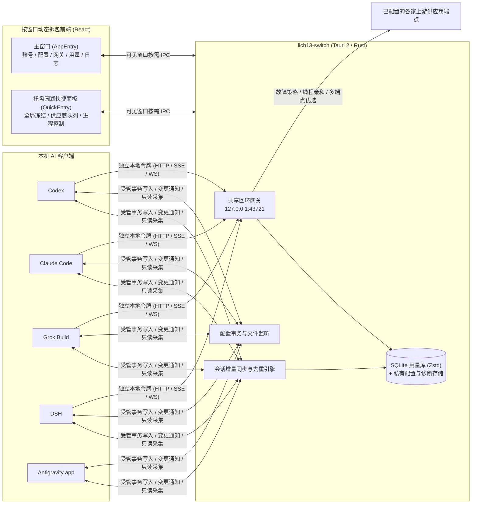

# lich13-switch


面向 **macOS** 与 **Windows** 的本地多客户端 AI 账号、配置与 API 网关工作台（基于 **Tauri 2 + Rust + React** 构建）。统一管理 **Codex**、**Claude Code**、**Grok Build**、**DSH** 的独立供应商队列与本地流量调度，并原生支持 **Antigravity app** 的双模配置编辑、增量会话用量核算与账单导出。

> **安全提示**：所有账号凭据、供应商密钥与配置文件均保存在本机当前系统账户目录下（默认未加密），不会上传至任何第三方或项目服务。请按原客户端凭据的安全级别妥善保管本机文件；官方与第三方 API 配置隔离不承诺规避上游平台风控。

---

## 核心特性

### 1. 共享端口与多客户端隔离网关
- **单端口令牌分流**：默认监听 `127.0.0.1:43721`，通过各客户端独立的本地访问令牌在根路径／`/v1` 精确鉴权与分流，同时保留 `/codex`、`/claude`、`/grok` 兼容前缀；HTTP、SSE 与原生 WebSocket 全程保持原协议透传，不做有损消息转换。
- **精细准入与限流**：四客户端各自隔离供应商优先级队列、并发上限（含 Codex 线程空闲预留明细）、滚动一分钟 RPM 窗口保护以及模型级健康作用域（`客户端 + 供应商 + 凭据版本 + 请求模型`）。
- **多端点测速优选**：每家供应商支持主地址与最多 8 个辅助 `base_url`；网关按需对多端点发起无凭据预热与响应头延迟探测，新连接自动优选最低延迟可达端点，固定线程与响应游标保持原端点不漂移。
- **安全启停与恢复**：首次安装所有网关默认关闭；后续启动按上次启用意图恢复（支持开机静默启动），跨文件接入写入具备私有事务快照与外部修改冲突保护。

### 2. Codex 线程亲和、压缩交接与故障策略引擎
- **线程归属与按代次接管**：精确识别 Codex `thread-id`（排除缓存亲和性 `session-id` 与空预热），支持按供应商独立开启「新线程接管」与「上下文压缩后接管」，按 owner epoch 与压缩边界代次原子交接，严守已输出内容不重放边界。
- **统一故障策略与搜索**：内置结构化错误封套分类器（区分 RPM／Token／并发临时限流、周期额度／余额耗尽、认证失效、5xx 与传输断流）；支持单框粘贴 HTTP 状态码、业务错误码、原始消息或 JSON 自动定位命中策略，并可添加客户端自定义故障规则。

### 3. 供应商连接测试与模型真伪核验
- **直连对话与数字指纹**：按供应商独立执行流式连接测试（全局共用测试文案自动保存）、**ModelTrace** 与 **LM Detector** 模型指纹挑战及可选分词器探测，所有评分均在本地完成。
- **自适应定时巡检**：支持固定周期或按近一小时真实业务请求量动态分档（5–30 分钟，零调用自动暂停）的智能定时检测；识别低家族混用或汇总降智时自动标记并移出自动队列。

### 4. 多客户端账号切换与双模配置中心
- **Codex 账号库**：支持 ChatGPT 浏览器登录、设备码登录（一键复制链接与设备码）、指定账号设备码无损刷新、官方账号直连模式，以及 Codex / Sub2API / CLIProxyAPI 批量导入导出与 CC Switch 链接队列导入。
- **跨客户端接入管理**：Claude Code 支持「官方／API」全局配置档独立切换与官方 CLI 登录；Grok Build 支持只读发现、`endpoint.env` 字面量解析并迁入独立 API 模型（与原生官方模型并存）；DSH 支持多 profile 统一接入与官方模型目录映射。
- **双模配置编辑器**：
  - **Claude Code**（`settings.json`）与 **Antigravity app**（`config.json`）提供「可视化 | JSON」双模同步编辑，支持分组表单、高级 JSON 树无损保留未知／插件字段、敏感值遮蔽、脱敏改动对比、私有快照备份与「恢复上次配置」。
  - **Codex / Grok Build**（`config.toml`）与 **DSH**（profile / home YAML patch）提供语法高亮、即时校验与外部文件变更监听（干净草稿自动同步，未保存草稿触发版本冲突保护）。

### 5. 去重用量核算、压缩存储与账单导出
- **双向增量去重**：网关流式计量（含首字延迟 TTFT、输出 TPS、缓存读／写 TTL 明细、推理 Token 与网络搜索计费）与本机 Codex、Claude Code、Grok Build、Antigravity app 会话文件增量扫描自动关联补齐，未变化会话按文件游标跳过重扫。
- **紧凑本地存储**：SQLite 用量库采用计量列分离、内容摘要共享定价基座与带校验和的 Zstd 字典无损压缩，主库与 WAL 合计以约 `80 MiB` 为常态维护目标（7 天后归档无异常成功请求的细粒度诊断，30 天后收敛历史明细为日汇总）。
- **多源定价与账单导出**：支持固定价格优先、`Wei-Shaw` 自动价格同步、`models.dev` 索引补缺及供应商模型精确映射；支持导出 **Claude Code** 与 **Antigravity app** 精确到秒的核对账单，并可选按导出截止秒原子清理已结清历史记录。

### 6. 圆润快捷面板、全局冻结与低占用后台
- **多色调界面与按窗口动态拆包**：采用青、钴蓝、靛紫多色调深浅主题与模块化样式架构；托盘窗口（`?panel=quick`）与主窗口按入口动态拆包加载，互不冗余占用前端资源。
- **卡片式圆润快捷面板**：菜单栏／托盘左键直达独立圆润面板，集成全局冻结卡、平台胶囊切换、供应商拖拽排序、实时额度与并发／RPM 就地调整、超 60 秒长等待请求逐条中止，以及分平台一键退出客户端 CLI 进程。
- **全局冻结与电源助手**：支持一键「全局冻结」（等待在途请求与网关任务安全收尾后展示冰晶休眠就绪态）与 macOS 防合盖休眠电源助手（`lmfpd`）；窗口隐藏时自动挂起非必要前端广播与轮询，空闲状态下后台线程按事件按需唤醒。

---

## 客户端支持矩阵

| 客户端 | 默认本地网关入口 | 接入与认证机制 | 配置编辑支持 | 用量采集与账单 |
| --- | --- | --- | --- | --- |
| **Codex** | `127.0.0.1:43721/v1` | Bearer 两字段或普通 API 跨文件事务；ChatGPT OAuth 账号库与官方直连 | `config.toml` 原文校验、受管字段保护与上次配置恢复 | 网关实时计量 + 本机活跃／归档会话双向去重 |
| **Claude Code** | `127.0.0.1:43721` | `settings.json` 环境变量接入；官方／API 配置档隔离切换 | `settings.json` **可视化（5 分组）+ JSON** 双模编辑 | 网关实时计量 + 主／子代理会话去重 + **账单导出** |
| **Grok Build** | `127.0.0.1:43721/v1` | 独立受管 API 模型接入，保留原生官方 OAuth 模型自由切换 | `config.toml` 原文校验与 `endpoint.env` 导入预览 | 网关实时计量 + 原生多模型轮次独立统计 |
| **DSH** | `127.0.0.1:43721/v1` | Chat Completions 协议；全 profile 事务同步与官方模型目录映射 | `desktop` / 各 profile YAML patch 编辑与恢复 | 网关实时请求与模型调用计量 |
| **Antigravity app** | —（不经过本地网关） | 本机应用直连上游；`lich13-switch` 本地只读协同 | `config.json` **可视化（4 分组）+ JSON** 双模编辑与备份恢复 | 本机 RPC／`brain` 会话增量采集 + **账单导出与清理** |

---

## 架构概览



---

## 安装与完整性校验

从 [GitHub Releases](https://github.com/lich13/lich13-switch/releases) 下载对应平台安装包：

- **macOS（Apple Silicon）**：`.dmg` 磁盘映像（采用 ad-hoc 签名，首次打开如遇系统拦截请按 macOS 提示在「系统设置 → 隐私与安全性」中确认打开）。
- **Windows（x64）**：NSIS `.exe` 安装程序（未附带商业代码签名，SmartScreen 提示时确认运行即可）。

下载后建议使用同一 Release 附带的 `SHA256SUMS` 校验安装包哈希：

```sh
# macOS
shasum -a 256 -c SHA256SUMS --ignore-missing
```

```powershell
# Windows PowerShell
Get-FileHash .\lich13-switch_*.exe -Algorithm SHA256
```

历史版本演进详见 [发布说明 (RELEASE.md)](RELEASE.md)。

---

## 快速上手

1. **配置并启用网关**：打开主窗口「网关」页，选择目标客户端（Codex / Claude Code / Grok Build / DSH），添加至少一家供应商并按需调整队列顺序、并发与 RPM 上限；打开网关开关后，按提示重新打开对应客户端使连接生效（运行中切换供应商仅作用于新请求，不中断已有流）。
2. **管理 Codex 账号与多端接入**：在「账号」页登录 ChatGPT 或导入已有 `auth.json`／Sub2API／CLIProxyAPI 凭据；Claude Code 可在网关页或配置页一键切换「官方／API」模式；Grok Build 与 DSH 可通过页头入口完成首次配置识别与接入。
3. **双模编辑客户端配置**：在「配置」页切换客户端，使用可视化表单或代码编辑器维护配置；保存前可通过「查看改动」核对脱敏差异，误改后可点击「恢复上次配置」载入最近一次私有备份草稿。
4. **使用托盘快捷面板与全局冻结**：左键点击系统菜单栏／托盘图标唤起圆润快捷面板，随时切换供应商、查看余额额度、中止超时长等待请求或退出后台 CLI 进程；合盖或休眠前可点击顶部「全局冻结」，待指示灯变为冰蓝色「可休眠」后安全休眠。
5. **核对用量、导出账单与排查异常**：在「用量」页按时间、客户端、供应商与模型查看去重费用及首字性能，或点击「导出账单」导出 Claude Code 与 Antigravity app 账单；遇到上游报错或熔断时，在「日志」页查看脱敏原始响应并一键跳转定位「故障策略」。

更多分专题说明：
- [设计系统与完整交互规范 (DESIGN.md)](DESIGN.md)
- [账号登录、导入导出与客户端配置 (docs/clients.md)](docs/clients.md)
- [客户端网关、线程调度与故障转移 (docs/gateway.md)](docs/gateway.md)
- [快捷面板、额度展示与系统控制 (docs/controls.md)](docs/controls.md)
- [用量采集、去重与计价口径 (docs/usage.md)](docs/usage.md)
- [本地数据目录、事务恢复与清理边界 (docs/data.md)](docs/data.md)

---

## 隐私、网络与存储边界

- **零遥测与本地自治**：应用不含广告、统计埋点或云端账号同步。内部应用标识保持 `com.lich13.gpt-switch` 以兼容既有本地私有数据目录。
- **明确的网络边界**：业务转发、额度刷新、模型目录拉取、无凭据多端点测速与模型指纹挑战仅发往用户显式配置的供应商地址；其余应用直接请求仅限用户检查更新（GitHub Releases API）、自动／手动同步公开模型价格（`Wei-Shaw/model-price-repo` / `models.dev`）以及用户手动更新公开指纹库资源。源码硬编码域名由 `scripts/check-network-hosts.py` 与 `scripts/network-hosts.json` 离线静态门禁严格校验。
- **脱敏诊断与仓库规范**：诊断日志自动过滤敏感头与路径，不保存请求／响应正文或账号邮箱；仓库源码与测试统一使用 `example.invalid`、回环地址与 `fixture` 脱敏夹具。
- 完整数据清单与网络矩阵请参阅 **[隐私与安全 (PRIVACY.md)](PRIVACY.md)**。发现安全隐患请通过 [GitHub Security Advisories](https://github.com/lich13/lich13-switch/security/advisories/new) 私下报告。

---

## 本地开发与验证

### 环境要求
- **Node.js**：版本见 [.nvmrc](.nvmrc)
- **pnpm**：版本固定于 [package.json](package.json) 的 `packageManager` 字段（项目启用 `pmOnFail: ignore` 以保持单文档锁文件兼容 GitHub 依赖图，请通过 `corepack` 启用对应版本）
- **Rust**：工具链与组件见 [rust-toolchain.toml](rust-toolchain.toml)
- **平台系统依赖**：参见 [Tauri v2 Prerequisites](https://v2.tauri.app/start/prerequisites/)

### 常用命令

```sh
# 1. 核对包管理器并安装前端依赖
corepack pnpm --version
corepack pnpm install --frozen-lockfile

# 2. 前端测试、类型检查与生产构建
corepack pnpm test
corepack pnpm build

# 3. Rust 单元测试、Clippy 静态检查与格式校验
cargo test --locked --manifest-path src-tauri/Cargo.toml
cargo clippy --locked --manifest-path src-tauri/Cargo.toml --all-targets -- -D warnings
cargo fmt --manifest-path src-tauri/Cargo.toml -- --check

# 4. 源码域名白名单与本地错误码一致性门禁
python3 scripts/check-network-hosts.py
python3 scripts/check-error-codes.py
python3 -m unittest discover -s scripts -p "test_*.py"

# 5. 重新生成全套应用与托盘图标 / 启动桌面开发模式
corepack pnpm icons
corepack pnpm tauri dev
```

- `corepack pnpm dev` 仅启动带「预览」标识的浏览器模拟界面，不读写任何真实客户端凭据。
- 桌面构建产物支持 `--smoke-test <绝对输出路径>` 参数：在独立临时目录中端到端验证 WebView、托盘、账号切换、共享网关鉴权、配置事务写入与退出恢复，全程不触碰本机真实客户端目录。

---

## 依赖维护与安全审计

- **Dependabot 策略**：每周一 `09:00 (Asia/Taipei)` 检查 Cargo、前端与 GitHub Actions（普通更新冷却 7 天，安全更新走独立通道立即触发）。Cargo 采用 `lockfile-only` 与兼容 `minor/patch` 约束维护主锁文件（含本地 `lmfpd` 审计）；前端按 React 核心（保持 `react` 与 `react-dom` 同版本）、运行依赖、开发工具分 3 组；GitHub Actions 保持固定提交 SHA。
- **关键兼容约束**：
  - `tauri` 运行时保持 `2.11` 系列，宏、构建与代码生成组件保持兼容的 `2.6` 系列，升级主包时成组评估。
  - `yaml-edit` 固定 `0.3.2`，保障 DSH 空数组、注释及外部修改保护往返测试稳定通过。
- **漏洞审计**：执行 `cargo audit --file src-tauri/Cargo.lock` 与 `corepack pnpm audit`。当前 `Cargo.lock` 中仅存 5 条由 Tauri Linux GTK 3 / D-Bus 单实例链路引入的上游间接警告（`proc-macro-error 1.0.4` / `RUSTSEC-2024-0370`、`glib 0.18.5` / `RUSTSEC-2024-0429`、`zvariant 5.15.1` / `RUSTSEC-2026-0370`、`zbus_names 4.3.5` / `RUSTSEC-2026-0371`、`zvariant_derive 5.15.1` / `RUSTSEC-2026-0372`），均不在 macOS 与 Windows 目标依赖树中，遵循不添加忽略列表隐藏警告的原则保留可见并随上游迁移更新。

---

## 许可证

MIT License。独立开源项目，与 OpenAI、Anthropic、xAI、Google 等厂商无隶属关系。
